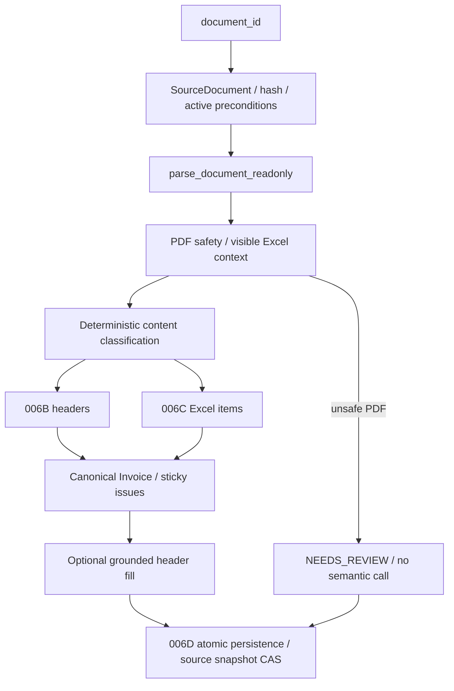

# TASK-006E — Invoice Extraction Service

Status: IN_PROGRESS  
Priority: P1  
Parent: TASK-006  
Developer: Codex — Main Developer  
Reviewer: Antigravity — Independent Technical Reviewer / QA  
Updated: 2026-10-29  
Dependencies: TASK-006B DONE, TASK-006C DONE, TASK-006D DONE

## Objective

Compose the approved Invoice extraction components into the production application service.

## In scope

- primary input document_id;
- safely classified COMMERCIAL_INVOICE gate;
- non-mutating downstream parse/read path;
- TASK-005A visual safety gate;
- deterministic headers + items;
- provider-neutral semantic fallback interface;
- strict semantic grounding/type validation;
- conservative fill-only merge;
- deterministic conflicts remain sticky;
- unsafe visual conflict bypasses semantic fallback and goes directly to NEEDS_REVIEW;
- explicit safe re-extraction through TASK-006D policy;
- privacy-safe logs;
- production composition factory.

## Out of scope

- hosted AI/provider SDK;
- TASK-009 normalization;
- matching/rules;
- Packing/Bill extraction.

## Key acceptance

- unsafe visual document is never sent to semantic fallback;
- wrong semantic document/provenance/type -> typed issue + review;
- semantic cannot overwrite deterministic accepted values/conflicts;
- source file remains immutable;
- no parser status downgrade;
- no SQL in application service;
- full regression stays green.

Baseline is the exact approved TASK-006D full-suite result.

## Implementation policy

- Baseline independently verified: 435 passed, 0 failed, 0 skipped, 2 warnings in 9.24s.
- Correct existing branch selected from a clean checkout before development: `task/006e-invoice-extraction-service`, HEAD `cd875b9`. Approved TASK-006D closure was verified read-only from `main` commit `501424c`; this branch predates that documentation-only commit. No merge was performed.
- `InvoiceExtractionService.extract_document(document_id, *, expected_active_extraction_id=None, expected_source_file_hash=None, expected_processing_status=None)` returns typed result and an optional committed record. No record means no successful persistence; result status never substitutes for the active-result API.
- `DocumentParsingService.parse_document_readonly()` is a separately named path which never writes metadata. Legacy classification parsing remains backward compatible.
- Stored Commercial Invoice classification, confidence and eligible state are required. The existing deterministic classifier rechecks the current safety-approved content, omitting hidden/formula Excel classification clues. No filename evidence or second classification-metadata write is used.
- Source bytes are SHA-256 checked against stored metadata before processing and again before persistence. Full SourceDocument snapshot changes also refuse persistence. An optional backward-compatible `expected_source_document` guard strengthens TASK-006D's existing input/transaction check so same-hash/status classification or path changes cannot race the service's final read. No SQLite schema, active/history semantics or approved extraction model changed. The application does not execute SQL.
- Native PDFs bypass vision. Any unusable page needs configured visual resolution; unresolved, unverified, conflicting, low-confidence or incomplete resolution abstains for the entire document with NEEDS_REVIEW and no semantic call. Existing 005A single-provider/cross-verified resolutions are accepted only after the shared text-quality check. PDF items are unsupported and always retain a review issue.
- Excel assembles approved header and item results into canonical `Invoice.items`, retaining source candidates/issues and Decimal/date types. Hidden content cannot provide trusted header values. Models are freshly revalidated before persistence.
- Semantic fallback is optional, absent by default, with no vendor SDK. It receives only eligible labeled header evidence, and may fill only missing approved header paths. Source location/raw text/label role/type must independently agree. No semantic item-list merge or item matching is supported. Deterministic issues, formula uncertainty and conflicts remain sticky.
- Preconditions (invalid/missing source, unsafe classification, wrong type, stale state/hash, missing explicit replacement) produce no write. Technical parsing/deterministic failures after verified-source preflight become FAILED attempts. Unsafe visual content becomes a NEEDS_REVIEW attempt. Persistence conflicts/errors cause no second write or retry. FAILED replacements retain the previous active extraction through the unchanged 006D repository.
- Production factory: `build_invoice_extraction_service(repository=None, *, semantic_provider=None)`. Existing visual factory remains optional/lazy; no hosted providers are included.
- Decision record: `docs/decisions/ADR-002-invoice-extraction-service.md`.

## Developer validation — 2026-10-29

Python 3.13.14, pytest 9.1.1. Tests use synthetic sources and temporary SQLite
databases outside the repository. Commands use `python -B -m pytest`,
`-p no:cacheprovider`, and an explicit external `--basetemp` for execution.

| Scope / pytest arguments | Collected | Passed | Failed | Skipped | Warnings | Runtime |
|---|---:|---:|---:|---:|---:|---:|
| Pre-development baseline `-v` | 435 | 435 | 0 | 0 | 2 | 9.24s |
| `tests/unit/application -v` | 86 | 86 | 0 | 0 | 0 | 6.43s |
| `tests/unit/extraction/test_semantic.py -v` | 52 | 52 | 0 | 0 | 0 | 1.52s |
| `--collect-only -q` | 566 | — | — | — | 2 | 1.28s |
| Full `-v` | 566 | 566 | 0 | 0 | 2 | 16.79s |

The three new test files cover actual synthetic PDF/XLSX/XLS plus SQLite
integration within the focused application suite, readonly parsing/state,
classification/vision gates, semantic adversarial outputs, sticky conflicts,
source immutability, explicit re-extraction, safe rollback and privacy. Existing
TASK-001 through TASK-006D regression remains green. Warnings are existing
Starlette/httpx and AnyIO BlockingPortal deprecations.

An internal safety probe found same-hash/status classification mutation immediately
before repository save. The optional transaction snapshot guard and regression
tests for first save and replacement now reject it, without inserting an attempt
or damaging the prior active row. Antigravity must independently audit this new
guard, semantic role grounding, unsafe-vision call counts and status aggregation.

## Dependency flow

## Known limitations

- PDF item extraction remains unsupported and always needs review.
- Semantic coverage is limited to explicit approved header labels and independently
  verified adjacent/inline values; no free-form inference or semantic items.
- Whole-document PDF abstention includes an otherwise native document with one
  unusable page. Local vision uses the approved 005A quality policy; no hosted
  provider was installed or tested.
- Hash checks do not lock uploaded files against external writes after the final
  check. Metadata snapshot CAS is atomic inside the managed SQLite transaction.
- Repository constraint errors and write-time optimistic conflicts share the
  approved safe exception; an uncommitted write is reported as FAILED, without a
  second attempt or retry. Preflight stale requests remain typed review refusals.
- No cross-stage OCR result cache, user authentication, HTTP route, normalization,
  matching or background execution was added.

## Review state

Developer implementation requires independent Antigravity review. This task is not approved or DONE.
